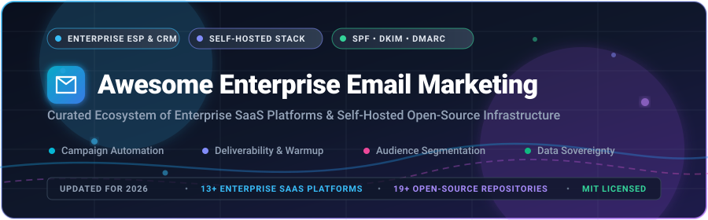

<p align="center">
  
</p>

# 📧 Awesome Enterprise Email Marketing

<p align="center">
  <a href="https://github.com/ishandutta2007/Awesome-Awesome-Awesome"></a><a href="https://discord.gg/jc4xtF58Ve"></a>
  <a href="https://github.com/ishandutta2007/Awesome-Enterprise-Email-Marketing/stargazers"></a>
  <a href="https://github.com/ishandutta2007/Awesome-Enterprise-Email-Marketing/pulls"></a>
  <a href="https://github.com/ishandutta2007/Awesome-Enterprise-Email-Marketing/graphs/commit-activity"></a>
  <a href="https://github.com/ishandutta2007"></a>
</p>

> 🚀 **A curated directory of enterprise-grade SaaS email platforms, self-hosted marketing automation suites, and open-source email infrastructure.**  
> 🎯 *Engineered for high-volume campaign automation, subscriber segmentation, strict deliverability management (SPF, DKIM, DMARC), and complete data sovereignty.*

---

## 📑 Table of Contents

- [🌐 Sector Overview & Market Dynamics](#-sector-overview--market-dynamics)
- [🏢 Enterprise SaaS & Hosted Platforms](#-enterprise-saas--hosted-platforms)
- [🛠️ Open-Source & Self-Hosted Infrastructure](#-open-source--self-hosted-infrastructure)
  - [📦 GitHub Projects (Ranked by Stars)](#-github-projects-ranked-by-stars)
  - [🧰 Additional Tools & Mailing List Engines](#-additional-tools--mailing-list-engines)
- [⚙️ Recommended Architectural Stacks](#-recommended-architectural-stacks)
- [🤝 How to Contribute](#-how-to-contribute)
- [💖 Support & Community](#-support--community)
- [📈 Star History](#-star-history)
- [⚖️ Disclaimer & Regulatory Compliance](#-disclaimer--regulatory-compliance)

---

## 🌐 Sector Overview & Market Dynamics

The global **email marketing software** market is valued at approximately **$1.9B – $2.1B** (with the broader digital marketing, customer relationship management (CRM), and omnichannel messaging market standing at **$13.7B+ in 2026** and forecasted to surpass **$22B – $30B by 2030** at an estimated 10.6%–12.2% CAGR).

The sector demonstrates **moderate market concentration**: the enterprise and mid-market tiers are dominated by entrenched suites (**Salesforce Marketing Cloud, Adobe Marketo, Oracle Eloqua, Intuit Mailchimp, and Klaviyo**), while the broader landscape remains **deeply fragmented** across specialized vertical ESPs, developer-centric transactional APIs (Resend, Postmark, SendGrid), and self-hosted open-source software built for teams requiring full data privacy, GDPR compliance, and independent sending infrastructure.

---

## 🏢 Enterprise SaaS & Hosted Platforms

A side-by-side comparative analysis of leading enterprise and commercial email marketing suites, sorted in descending order of **company scale (valuation / annual revenue)**.

| Platform / Vendor | Company Scale (Valuation / Revenue) | Core Enterprise Capabilities | Starting Pricing Tier | Free Tier / Free Trial Limits |
| :--- | :--- | :--- | :--- | :--- |
| **[Oracle Eloqua](https://www.oracle.com/cx/marketing/automation/)** | **~$425B Valuation**<br>($67.4B Revenue FY26) | 🏛️ Enterprise B2B marketing automation, dynamic lead scoring, complex multi-step campaign orchestration, CRM sync. | **$2,000 / month**<br>(Basic edition, up to 10,000 contacts, billed annually) | **30-day proof-of-concept trial** in sandbox environment via sales consultation (no public self-serve free plan) |
| **[Salesforce Email Studio](https://www.salesforce.com/products/marketing-cloud/email/)** | **~$210B Valuation**<br>($41.5B Revenue FY26) | ☁️ Native Marketing Cloud ESP; Journey Builder, Einstein AI predictive send-time optimization, unified Data Cloud integration. | **$1,250 / month**<br>(Marketing Cloud Growth, up to 10,000 contacts; or $25/user/mo for Starter Suite) | **30-day free trial** via Salesforce Starter Suite (up to 25,000 email sends, no credit card required); enterprise POC sandbox available |
| **[Marketo Engage (Adobe)](https://business.adobe.com/products/marketo/marketo-engage.html)** | **~$100B Valuation**<br>($25.9B Revenue TTM) | 🎨 Enterprise B2B lead nurturing, account-based marketing (ABM), revenue attribution, multi-touch analytics. | **$895 / month**<br>(Growth tier, up to 10,000 database contacts, billed annually) | **14-day sales-provisioned sandbox POC trial** with guided interactive product tour (no public self-serve free plan) |
| **[Mailchimp Enterprise (Intuit)](https://mailchimp.com/)** | **~$84B Valuation**<br>($21.5B Revenue FY26) | 🐵 Advanced segmentation, generative AI content assistant, multivariate split testing, Mandrill transactional API relay. | **$350 / month**<br>(Premium tier, starting at 10,000 contacts; entry plans from $13/mo for 500 contacts) | **Free forever plan**: up to 500 contacts and 1,000 emails/month (daily limit: 500 sends); 30-day free trial on paid plans |
| **[HubSpot Marketing Hub](https://www.hubspot.com/products/marketing)** | **~$30B Valuation**<br>($2.6B Revenue) | 🎯 All-in-one inbound marketing CRM, automated email journeys, smart send frequency capping, revenue attribution. | **$15 / month**<br>(Starter plan per core seat; Professional tier starts at $800/mo for 2,000 contacts) | **Free forever plan**: up to 2,000 email sends/month, CRM contact storage, 1 shared inbox; 14-day free trial for Professional tier |
| **[Klaviyo](https://www.klaviyo.com/)** | **~$4.8B Valuation**<br>($1.23B Revenue FY25) | 🛍️ E-commerce behavioral email & SMS automation, predictive customer lifetime value (CLV), native Shopify & Magento sync. | **$20 / month**<br>(Email plan, up to 500 contacts and 5,000 email sends/month) | **Free forever plan**: up to 250 contacts, 500 email sends/month, and 150 free SMS credits |
| **[Iterable](https://iterable.com/)** | **~$3.6B Valuation**<br>(~$200M+ ARR) | ⚡ Cross-channel customer engagement, visual drag-and-drop workflow canvas, AI-driven predictive churn scoring, real-time segmentation. | **$1,500 / month**<br>(Starting tier up to 25,000 active contacts / MAUs, billed annually) | **30-day proof-of-concept trial** with dedicated onboarding engineer upon enterprise qualification |
| **[Braze](https://www.braze.com/)** | **~$3.1B Valuation**<br>($738M Revenue FY26) | 📱 Real-time cross-channel customer engagement (email, push, SMS, in-app), Canvas journey builder, high-throughput delivery engine. | **$2,500 / month**<br>(Growth package, up to 100,000 Monthly Active Users, billed annually) | **14-to-30-day customized POC sandbox** with sample data and deliverability testing for qualified enterprises |
| **[ActiveCampaign](https://www.activecampaign.com/)** | **~$3.0B Valuation**<br>(~$250M ARR) | 🤖 Sophisticated email automation recipes, built-in sales CRM, predictive sending algorithms, automated tag management. | **$15 / month**<br>(Starter tier, 1,000 contacts billed annually; Plus tier from $49/mo) | **14-day free trial** with full automation features, up to 100 contacts and 100 email sends (no credit card required) |
| **[Campaign Monitor (Marigold)](https://www.campaignmonitor.com/)** | **~$1.2B Valuation**<br>(~$250M+ ARR) | 📰 Designer-friendly drag-and-drop email builder, responsive template library, dynamic audience segmentation, transactional relay. | **$11 / month**<br>(Lite plan, up to 500 contacts, 2,500 email sends/month) | **Unlimited free trial**: full template & campaign builder access allowing test sends to up to 5 subscribers (no expiry) |
| **[Brevo (formerly Sendinblue)](https://www.brevo.com/)** | **~$1.2B Valuation**<br>(~$150M+ ARR) | 💬 Omnichannel marketing (email, SMS, WhatsApp, chat), transactional SMTP API, visual automation builder, landing pages. | **$9 / month**<br>(Starter plan, up to 5,000 emails/month, unlimited subscriber contacts) | **Free forever plan**: unlimited contacts, up to 300 emails/day (approx. 9,000 emails/month) |
| **[Constant Contact](https://www.constantcontact.com/)** | **~$1.1B Valuation**<br>(~$150M–$200M ARR) | 📮 Small-to-mid business email campaigns, event registration management, automated welcome series, social media integration. | **$12 / month**<br>(Lite plan, up to 500 contacts, 1 user account) | **14-day free trial** with access to all template builders and up to 100 test email sends (no credit card required) |
| **[Acoustic Campaign](https://acoustic.com/)** | **~$900M Valuation**<br>(~$150M ARR) | 🧠 AI-powered multichannel journeys, behavioral customer analytics, deliverability monitoring, GDPR-ready enterprise deployment. | **$1,500 / month**<br>(Professional tier, starting at 100,000 monthly message events) | **14-day guided proof-of-concept sandbox** with solution architecture consultation upon sales qualification |

---

## 🛠️ Open-Source & Self-Hosted Infrastructure

Self-hosting gives organizations **100% data ownership**, eliminates per-contact pricing, and protects customer privacy under **GDPR, CCPA, and HIPAA**.

### 📦 GitHub Projects (Ranked by Stars)

Listed below are top open-source email platforms, mailing list managers, and sending engines, **sorted in descending order of GitHub Stars_Count**:

- **[Listmonk](https://github.com/knadh/listmonk)** [](https://github.com/knadh/listmonk/stargazers)  
  ⚡ *High-performance, self-hosted newsletter and mailing list manager (AGPL-3.0).* Built in Go with PostgreSQL. Features blazingly fast multi-threaded bulk sending, subscriber attributes, dynamic segmentation, transactional messages, and lightweight resource usage.

- **[docker-mailserver](https://github.com/docker-mailserver/docker-mailserver)** [](https://github.com/docker-mailserver/docker-mailserver/stargazers)  
  🐳 *Production-ready, fullstack containerized mail server (MIT).* Bundles Postfix, Dovecot, Rspamd, ClamAV, OpenDKIM, and Fail2ban into a single Docker image without SQLite/database bloat. Ideal backbone for enterprise email dispatching.

- **[Postal](https://github.com/postalserver/postal)** [](https://github.com/postalserver/postal/stargazers)  
  📮 *Complete open-source mail delivery platform for incoming and outgoing email (GPL-3.0).* Designed as a self-hosted alternative to SendGrid, Postmark, and Mailgun. Includes SMTP server, HTTP REST API, webhooks, live logs, and spam scanning.

- **[MailHog](https://github.com/mailhog/MailHog)** [](https://github.com/mailhog/MailHog/stargazers)  
  🔍 *Web and API-based SMTP testing tool for developers (MIT).* Built in Go, it runs a fake SMTP server to catch and preview outgoing campaign messages, inspect headers, and verify templates without sending real emails.

- **[BillionMail](https://github.com/Billionmail/BillionMail)** [](https://github.com/Billionmail/BillionMail/stargazers)  
  💌 *All-in-one open-source MailServer, Newsletter, and Email Marketing platform (Apache-2.0).* Fully self-hosted, developer-friendly alternative to commercial ESPs with zero monthly fees, integrated sending queues, and web dashboard.

- **[mailcow: dockerized](https://github.com/mailcow/mailcow-dockerized)** [](https://github.com/mailcow/mailcow-dockerized/stargazers)  
  🐮 *Modern, modular mailserver suite (GPL-3.0).* Incorporates Dovecot, Postfix, SOGo groupware, Rspamd, ACME automated SSL, and a clean web administration UI with full DKIM/SPF/DMARC management out of the box.

- **[Mautic](https://github.com/mautic/mautic)** [](https://github.com/mautic/mautic/stargazers)  
  🌐 *The world's leading open-source marketing automation platform (GPL-3.0).* 100% community-owned and self-hosted with no contact caps. Provides multi-channel campaigns (email, SMS, web tracking), dynamic segmentation, visual flow builder, lead scoring, and GDPR compliance tools.

- **[Inbucket](https://github.com/inbucket/inbucket)** [](https://github.com/inbucket/inbucket/stargazers)  
  📥 *Disposable email testing and development server (MIT).* Written in Go. Captures incoming emails via SMTP and displays them through a web UI and REST API. Essential for staging environments and end-to-end campaign automation testing.

- **[Notifuse](https://github.com/Notifuse/notifuse)** [](https://github.com/Notifuse/notifuse/stargazers)  
  🚀 *Modern self-hosted email marketing and transactional platform (FSL-1.1-Apache-2.0).* Written in Go and React. Features a visual MJML drag-and-drop builder, Liquid templating, visual automation flows, and connectors for 7 sending relays (Amazon SES, Mailgun, Postmark, SendGrid, SparkPost, Mailjet, SMTP).

- **[Keila](https://github.com/pentacent/keila)** [](https://github.com/pentacent/keila/stargazers)  
  🔒 *Privacy-first, self-hosted newsletter platform (AGPL-3.0).* Built with Elixir/Phoenix and PostgreSQL. Offers double opt-in subscriber management, visual and Markdown editors, automatic bounce processing, captcha protection, and zero third-party tracking.

- **[SendPortal](https://github.com/mettle/sendportal)** [](https://github.com/mettle/sendportal/stargazers)  
  ✉️ *Open-source, self-hosted email marketing solution (MIT).* Built with PHP/Laravel. Enables running newsletters and marketing campaigns via external SMTP/API providers (SES, SendGrid, Mailgun, Postmark) at minimal cost.

- **[phpList](https://github.com/phpList/phplist3)** [](https://github.com/phpList/phplist3/stargazers)  
  📜 *Classic newsletter and email campaign manager (AGPL-3.0).* Proven, battle-tested software featuring subscriber list segmentation, automated bounce processing, plugin system, and multilingual web interface.

- **[Sympa](https://github.com/sympa-community/sympa)** [](https://github.com/sympa-community/sympa/stargazers)  
  👥 *Enterprise-grade mailing list manager (GPL-2.0).* Designed for large organizations, universities, and public institutions managing complex discussion lists, moderation workflows, and announcement channels.

- **[Camp](https://github.com/codersgyan/camp)** [](https://github.com/codersgyan/camp/stargazers)  
  🏕️ *Minimalist, self-hosted email marketing platform (MIT).* Built with Go and minimal dependencies. Fast setup, lightweight contact segmentation, and straightforward campaign dispatching.

- **[Reloop](https://github.com/reloop-labs/reloop)** [](https://github.com/reloop-labs/reloop/stargazers)  
  🔄 *Self-hosted transactional email API and campaign automation engine (Apache-2.0).* Resend-inspired platform with REST API, visual email builder, inbound email webhooks, and contact lists managed over PostgreSQL.

- **[Kling](https://github.com/Kling-to/kling)** [](https://github.com/Kling-to/kling/stargazers)  
  🛍️ *Self-hosted marketing automation for e-commerce (BSL 1.1 / Apache 2.0).* AI-assisted campaign creation, multi-channel messaging (email, SMS, WhatsApp), abandoned cart journeys, and 30+ segmentation filters.

- **[Helio](https://github.com/achref-soua/helio)** [](https://github.com/achref-soua/helio/stargazers)  
  🤖 *AI-native customer growth platform and journey orchestrator (AGPL-3.0).* Powered by the Temporal workflow engine. Unifies natural-language segments, predictive scoring, and multi-channel journeys.

- **[Mailat](https://github.com/dublyo/mailat)** [](https://github.com/dublyo/mailat/stargazers)  
  📬 *Self-hosted transactional email platform and unified inbox (MIT).* Built in Go with GoFrame and AWS SES integration. Features single and batch REST endpoints, templates, and SSE real-time updates.

- **[Ermes](https://github.com/giaggiola/Ermes)** [](https://github.com/giaggiola/Ermes/stargazers)  
  🛒 *Self-hosted email automation specifically tailored for Shopify (AGPL-3.0).* Visual drag-and-drop flow builder, order and product synchronization, Resend sending relay, and customer preference centers.

---

### 🧰 Additional Tools & Mailing List Engines

Non-GitHub distributions and specialized infrastructure components:

- **[GNU Mailman](https://gitlab.com/mailman/mailman)** — The venerable mailing list manager (GPL-3.0) for discussion lists and public e-newsletters, paired with **[HyperKitty](https://gitlab.com/mailman/hyperkitty)** (web archives) and **[Postorius](https://gitlab.com/mailman/postorius)** (management UI).
- **[Posta](https://hub.docker.com/r/jkaninda/posta)** — Self-hosted email delivery and inbound engine distributed via Docker Hub. Features REST API, SMTP relay, DKIM verification, and Prometheus metrics.
- **[CastMail2List](https://pypi.org/project/castmail2list/)** — Lightweight IMAP-based Python mailing list engine. Relays messages to subscriber lists without requiring MTA daemon configuration.
- **[Schleuder](https://0xacab.org/schleuder/schleuder)** — Encrypted, GPG-enabled mailing list manager (GPL-3.0) ensuring end-to-end privacy for sensitive enterprise communications.

---

## ⚙️ Recommended Architectural Stacks

Building a custom, production-ready, enterprise-grade email system by combining modular open-source layers:

```
┌─────────────────────────────────────────────────────────────────┐
│               1. Campaign & Journey Orchestration              │
│          Mautic (Automation)  •  Notifuse / Keila (Newsletters) │
└────────────────────────────────┬────────────────────────────────┘
                                 │
┌────────────────────────────────▼────────────────────────────────┐
│               2. High-Performance Dispatch Queue                │
│       Listmonk (Bulk Dispatcher)  •  Postal (Relay Gateway)    │
└────────────────────────────────┬────────────────────────────────┘
                                 │
┌────────────────────────────────▼────────────────────────────────┐
│             3. Mail Transfer Agent & Deliverability             │
│   docker-mailserver / mailcow  •  Amazon SES / Postmark Relay   │
│           (SPF Records • DKIM Signing • DMARC Alignment)        │
└────────────────────────────────┬────────────────────────────────┘
                                 │
┌────────────────────────────────▼────────────────────────────────┐
│               4. Staging, Testing & Observability              │
│       MailHog / Inbucket (SMTP Mocking)  •  Prometheus Metrics  │
└─────────────────────────────────────────────────────────────────┘
```

---

## 🤝 How to Contribute

Contributions are warmly welcomed! To suggest a new enterprise platform or open-source tool:

1. 🍴 **Fork this repository**.
2. 📝 **Edit `README.md`** following the existing table or list structure:
   - For SaaS products: include official link, company valuation/revenue, capabilities, exact starting price, and exact free tier/trial limits.
   - For open-source repos: include GitHub link, social Stars_Badge linked to `/stargazers`, license, and concise overview.
3. 🔀 **Submit a Pull Request** with a brief summary of the proposed tool.

---

## 💖 Support & Community

Thank you for exploring **Awesome Enterprise Email Marketing**! If this curated guide helps your team optimize deliverability, choose an ESP, or architect a self-hosted email marketing stack:

- ⭐ **Star this repository** to stay updated with quarterly benchmark refreshes.
- 🍴 **Fork and share** with email deliverability engineers and growth marketers.
- 💬 **Join the conversation** on [Discord](https://discord.gg/jc4xtF58Ve) or follow [ishandutta2007 on GitHub](https://github.com/ishandutta2007).
- ☕ **Sponsor the Project**: If you'd like to support ongoing research and open-source maintenance, consider buying a coffee on the [GitHub Sponsors Dashboard](https://github.com/sponsors/ishandutta2007).

<p align="left">
  <a href="https://github.com/sponsors/ishandutta2007">
    
  </a>
</p>

---

## 📈 Star History

[](https://star-history.dera.page/#ishandutta2007/Awesome-Enterprise-Email-Marketing&type=date&legend=top-left)

---

## ⚖️ Disclaimer & Regulatory Compliance

- 📋 This is a community-curated, educational directory — not a paid endorsement or financial advice.
- 🛡️ **Regulatory Compliance**: Enterprise email senders are legally required to comply with global privacy and anti-spam legislation, including **GDPR** (EU), **CAN-SPAM** (US), **CASL** (Canada), and **CCPA** (California).
- 🔐 **Deliverability Requirements**: Production senders must maintain strict sender authentication (**SPF**, **DKIM**, and **DMARC** with alignment) and honor Gmail and Yahoo 2024+ sender requirements (one-click unsubscribe headers, <0.3% spam rate threshold, reverse DNS PTR records).
